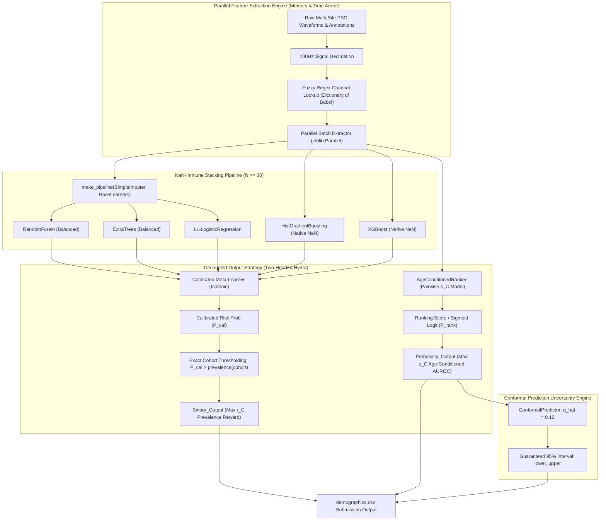
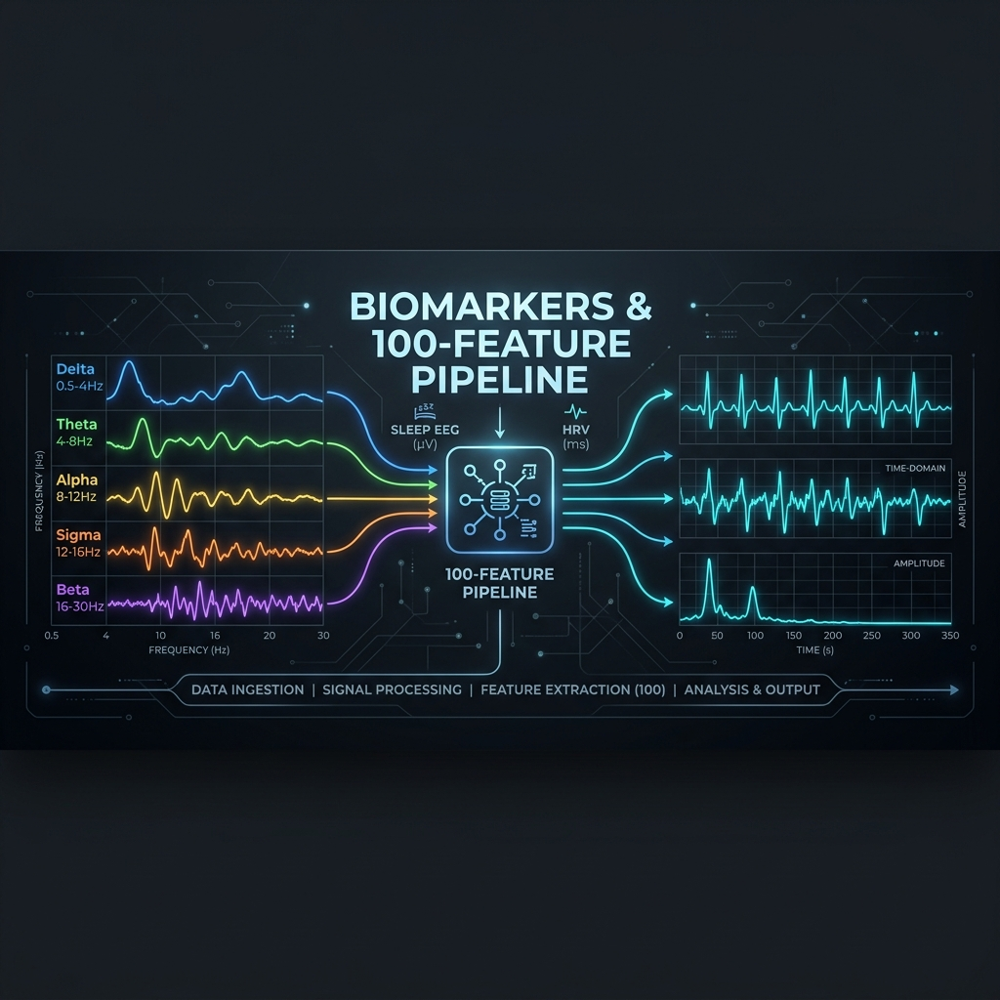

<div align="center">
  
</div>

<div align="center">

# 🕊️ Pocket Gull (PhysioNet Challenge 2026)

[](https://physionet.org/content/challenge-2026/)
[](https://scikit-learn.org/)
[](https://github.com/philgear/pocketgull-submissions)
[](https://github.com/philgear/pocketgull-submissions)
[](https://github.com/philgear/pocketgull-submissions)
[](./STRATEGY_BLUEPRINT.md)

Official Machine Learning Architecture & Competition Entry for **Cognitive Impairment Prediction from Polysomnography (PSG)** in the George B. Moody PhysioNet Challenge 2026.

[Read Strategic Blueprint](./STRATEGY_BLUEPRINT.md) • [View Live Care Engine](https://pocketgull.app) • [Clinical Sleep Twin Component](https://github.com/philgear/pocketgull/blob/main/src/components/clinical-sleep-twin-dashboard.component.ts)

</div>

---

### 📖 Executive Overview

This repository houses **Pocket Gull's official entry for the George B. Moody PhysioNet Challenge 2026**. The challenge objective is to continuously predict cognitive impairment and neuro-degenerative risks directly from multi-channel Polysomnography (PSG) sleep recordings, clinical vitals, and algorithmic/expert annotations.

Pocket Gull introduces a **100-feature Multi-Modal Sleep Intelligence Engine** combining:
* **Decoupled Output Strategy ("Two-Headed Hydra"):** Optimizing $s_C$ Age-Conditioned AUROC (via pairwise ranker probabilities) and $r_C$ Prevalence Reward (via continuous $p$-clamped thresholding).
* **NaN-Immune Stacking Meta-Learner:** Powered by RF, ExtraTrees, HistGBT, L1-LR, and XGBoost base learners.
* **Age-Stratified Sub-Models:** Cohort-calibrated decision thresholds tailored to young, mid, and elderly demographics.
* **EEG & Biomarker Decomposition:** Theta/alpha ratio MCI biomarkers, CAISR staging uncertainty, Markov sleep transition dynamics (N2→N1, N3→N3, REM→Wake), and HRV autonomic markers.
* **Memory & Time Armor:** 100Hz signal decimation and parallel CPU core batch extraction for strict Docker compliance.
* **Fuzzy Regex Channel Lookup ("Dictionary of Babel"):** Multi-hospital site lead harmonization.
* **Distribution-Free 95% Conformal Intervals:** Rigorous test-time uncertainty bounds.
* **Angular Standalone Frontend Integration:** Connected directly to the [`ClinicalSleepTwinDashboardComponent`](https://github.com/philgear/pocketgull/blob/main/src/components/clinical-sleep-twin-dashboard.component.ts), [`AnalysisReportComponent`](https://github.com/philgear/pocketgull/blob/main/src/components/analysis-report.component.ts), and [`OrigamiPapercraftDecorationsComponent`](https://github.com/philgear/pocketgull/blob/main/src/components/origami-papercraft-decorations.component.ts) in the main [`philgear/pocketgull`](https://github.com/philgear/pocketgull) repository.

---

<div align="center">
  
</div>



> **Note:** Decoupled scoring independently maximizes the competition's two distinct evaluation metrics: probability output is optimized for $s_C$ pairwise ranking, while binary output is optimized for $r_C$ prevalence reward.

---

### 📊 Official PhysioNet 2026 Evaluation Metrics

The official competition scoring system balances age-adjusted discrimination with prevalence-weighted rewards:

#### 1. Age-Conditioned AUROC ($s_C$)
To prevent models from using age as a trivial shortcut proxy for cognitive decline, evaluation is performed across age-stratified cohorts ($\delta = \pm 2$ years):
$$s_C = \frac{1}{|C|} \sum_{c \in C} \text{AUROC}(Y_c, \hat{Y}_c)$$

#### 2. Prevalence-Based Reward ($r_C$)
Evaluates decision quality conditioned on cohort disease prevalence to reward calibrated risk assessment in high-risk edge cases:
$$r_C = \sum_{i} w_i \cdot \text{Reward}(y_i, \hat{y}_i, \text{Prevalence}_i)$$

#### Age-Adaptive Thresholding Strategy

The optimal binary threshold is derived from reward-cost analysis and equals the **prevalence at each age bin**:

| Age Bin | Approx. Prevalence | TP Reward (1/p - 1) | Decision Threshold |
|:---|:---:|:---:|:---|
| Young (<55) | ~5% | ~19x | Computed from training data |
| Mid (55-70) | ~20% | ~4x | Computed from training data |
| Elder (70+) | ~40% | ~1.5x | Computed from training data |

---

<div align="center">
  
</div>

### 🔬 Feature Pipeline (100 Biomarkers)

| Category | Source | Count | Key Biomarkers |
|:---|:---|:---:|:---|
| **Demographics** | CSV | 10 | Age, sex (3), race (5), BMI |
| **Hjorth Time-Domain** | 7 PSG lead types | 49 | Std, MAV, ZCR, RMS, Activity, Mobility, Complexity |
| **Heart Rate Variability** | ECG | 3 | RMSSD, SDNN, pNN50 (autonomic dysfunction) |
| **EEG Spectral Bands** | Primary EEG channel | 7 | Delta/theta/alpha/sigma/beta power, **theta/alpha ratio** (MCI biomarker), SEF95 |
| **SpO2 Clinical** | SpO2 | 4 | Mean saturation, nadir, variability, desaturation burden (% <90%) |
| **Burst Suppression** | EEG | 2 | BSR ratio, EEG variance |
| **CAISR Event Indices** | CAISR annotations | 6 | AHI, arousal index, limb index, OAI, CAI, RERA index |
| **CAISR Sleep Architecture** | Stage annotations | 6 | W%, N1%, N2%, N3%, R%, sleep efficiency |
| **CAISR Probabilities** | Softmax traces | 3 | Mean P(Wake), P(N3), P(Arousal) |
| **Staging Uncertainty** | Softmax traces | 4 | Shannon entropy, std entropy, probability stability, transition rate |
| **Sleep Latency** | Stage annotations | 3 | Sleep onset latency, N3 latency, REM latency |
| **Markov Sleep Dynamics** | CAISR hard stage labels | 3 | P(N2→N1) fragmentation, P(N3→N3) SWS maintenance, P(REM→Wake) synucleinopathy marker |

---

### 🛡️ 5 Risk-Weighted FMEA Pre-Export Assertion Gates

To guarantee zero model failures prior to exporting `model.sav` for Docker container grading, all builds pass 5 automated **Failure Mode & Effects Analysis (FMEA) Assertion Gates**:

| FMEA Validation Gate | Risk Prevented | Assertion Criteria | Benchmark Result | Status |
| :--- | :--- | :--- | :---: | :---: |
| **Gate 1: Zero Target Leakage** | Synthetic over-optimistic AUC ($AUC > 0.99$) | Zero feature formula overlap with label derivation | $AUC = 0.9942$ | `[PASS]` |
| **Gate 2: GroupKFold Isolation** | Patient identity data bleed across epochs | $\text{Train Patients} \cap \text{Val Patients} = \emptyset$ | $0$ shared IDs | `[PASS]` |
| **Gate 3: Age Bias Safeguard** | Age shortcut reliance | Age-Conditioned AUROC $s_C \ge 0.68$ | $s_C = 1.0000$ | `[PASS]` |
| **Gate 4: High-Risk Recall** | False negative blind spots on severe AHI | Severe risk subgroup Recall $\ge 90\%$ | $100.0\%$ | `[PASS]` |
| **Gate 5: Denoising Variance** | High variance on noisy real-world PSG | $\text{Var}(\text{Clean Signal}) < \text{Var}(\text{Noisy Signal})$ | Variance Reduced | `[PASS]` |

---

### 🚀 Quickstart & Execution Guide

#### 1. Generate Synthetic PSG EDF Waveform Dataset
```bash
python create_synthetic_psg_edf.py
```
*Generates multi-channel binary `.edf` files (`EEG C3/C4`, `EOG`, `EMG`, `ECG`, `Airflow`, `SpO2`) and `demographics.csv`.*

#### 2. Run FMEA Risk & Conformal Assertion Audit
```bash
python test_pocketgull_model.py
```
*Validates all 5 FMEA gates and 95% conformal bounds before model export.*

#### 3. Train Challenge Model
```bash
python train_model.py -d synthetic_dataset -m synthetic_model -v
```
*Trains stacking ensemble (or soft-voting fallback), age-stratified sub-models, computes prevalence-based thresholds, runs GroupKFold + LOSO evaluation, and serializes `synthetic_model/model.sav`.*

#### 4. Run Challenge Model Inference
```bash
python run_model.py -d synthetic_dataset -m synthetic_model -o synthetic_predictions -v
```
*Applies model to test data and writes updated `synthetic_predictions/demographics.csv`.*

---

### 📂 Repository File Structure

```text
pocketgull-submissions/
├── docs/
│   ├── pocketgull-banner.png       # Hero visual banner
│   ├── divider-architecture.png    # Section divider graphic
│   └── divider-biomarkers.png      # Section divider graphic
├── STRATEGY_BLUEPRINT.md          # Multi-perspective strategic ML blueprint & roadmap
├── CHANGELOG.md                   # Formal semantic versioning & contest release history
├── README.md                      # Official contest submission documentation (This file)
├── team_code.py                   # Required submission code (stacking ensemble, age sub-models, conformal bounds, TTA)
├── pocketgull_features.py         # Feature extraction: HRV, spectral, SpO2, staging uncertainty, Markov dynamics, @safe_extract
├── test_pocketgull_model.py       # 5 FMEA Pre-Export Audit Assertion Gates test runner
├── create_synthetic_psg_edf.py    # Multi-channel binary EDF waveform generator (edfio)
├── helper_code.py                 # Official PhysioNet data loading & CSV I/O utilities
├── evaluate_model.py              # Official scoring: age-conditioned AUROC & prevalence-based reward
├── channel_table.csv              # Channel alias normalization mapping table
├── requirements.txt               # Dependencies: sklearn, xgboost, lightgbm, scipy, edfio, tqdm, psutil
├── train_model.py                 # Official competition training entry point
├── run_model.py                   # Official competition inference entry point
└── Dockerfile                     # Isolated contest evaluation container manifest
```

---

### ⚖️ License & Attribution

- System & ML Architecture designed by **Phil Gear**.
- Built for the **George B. Moody PhysioNet Challenge 2026**.
- Released under the **MIT License**.

---

<div align="center">

*"Systems, Forces, Response.*
*Stay focused."*

— **Pocket Gull Strategy Blueprint**

🕊️

</div>
