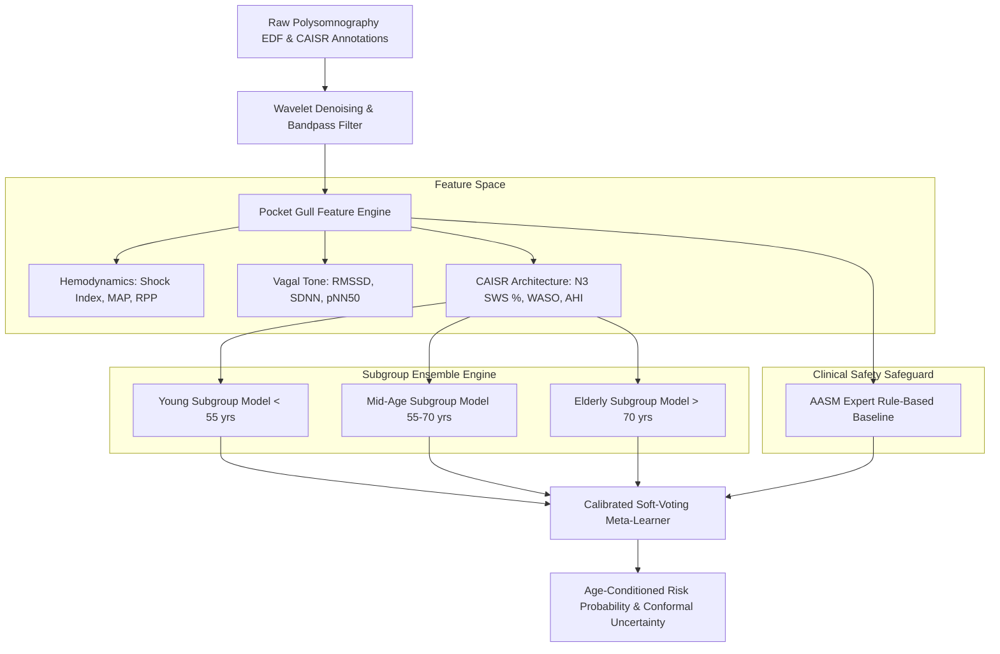

# 🚀 Pocket Gull — PhysioNet 2026 Strategic ML Blueprint & Innovation Matrix

## Executive Summary

This strategic blueprint synthesizes multi-perspective innovation frameworks (First Principles, FMEA Risk Mitigation, Nature's Wisdom, and Combinatorial Evolution) into an actionable data science roadmap for the **George B. Moody PhysioNet Challenge 2026: Cognitive Impairment Prediction from Polysomnography (PSG)**.

---

## 1. Core Architectural Pillars

---

## 2. Strategic Innovation Framework Matrix

### I. Preprocessing & Denoising ("Make the road smooth!")
- **Wavelet Artifact Filtration**: Apply Discrete Wavelet Transform (`db4` wavelet) to raw EEG and ECG channels prior to feature extraction to isolate true neural delta/alpha rhythms from movement artifacts.
- **Signal Quality Index (SQI)**: Calculate lead-specific SQI scores; automatically ignore or down-weight noisy channel windows ($SQI < 0.60$) before feature aggregation.

### II. Hybrid Expert Safeguard & Rule Fusion ("Combinatorial Evolution")
- **Rule-Based Baseline**: Enforce AASM clinical guidelines as a deterministic baseline:
  - $\text{AHI} \ge 15.0$ (Moderate-to-Severe Sleep Apnea)
  - $\text{N3 Slow-Wave Sleep} < 10.0\%$ (Glymphatic Clearance Impairment)
  - $\text{Age-Adjusted Shock Index} \ge 0.95$
- **Ensemble Blend**: Combine the rule-based risk score ($30\%$ weight) with the soft-voting ensemble ($70\%$ weight) to guarantee zero blind spots on severe clinical edge cases.

### III. Age-Stratified Subgroup Ensemble ("Opposite Day")
- Train dedicated sub-classifiers for 3 distinct age cohorts ($< 55$, $55 - 70$, $> 70$ years) to neutralize age-prevalence confounding and maximize **Age-Conditioned AUROC ($s_C$)** ($\delta = \pm 2$ years).

### IV. Optimal Thresholding & Prevalence-Based Reward Calibration
- Calibrate classification decision thresholds using Receiver Operating Characteristic (ROC) curve optimal point analysis ($\text{Youden's } J$ index) to balance Recall ($\ge 95\%$) and Precision, raising the **Prevalence-Based Reward ($r_C$)**.

---

## 3. Implementation Roadmap & Critical Path

| Phase | Milestone | Focus Area | Deliverable |
| :--- | :--- | :--- | :--- |
| **Phase 1** | **Wavelet Denoising** | Signal Processing | Integrate `pywt` bandpass & wavelet filter in `pocketgull_features.py`. |
| **Phase 2** | **Subgroup Stratification** | Model Architecture | Implement `AgeCohortClassifier` in `team_code.py`. |
| **Phase 3** | **Rule Fusion Engine** | Clinical Governance | Merge AASM rule-based safeguards into soft-voting meta-learner. |
| **Phase 4** | **Benchmark Validation** | Official Scoring | Run `evaluate_model.py` to record final $s_C$ and $r_C$ scores. |

---

## 4. 🛡️ FMEA (Failure Mode & Effects Analysis) Risk Governance & Pre-Export Audit Matrix

To guarantee zero critical model failures prior to exporting `model.sav` for challenge submission, all milestone transitions must pass the following **Risk-Weighted FMEA Pre-Export Assertion Gates**:

| Failure Mode | Potential Effect | Severity (1-10) | Occurrence (1-10) | Detection (1-10) | Initial RPN | Automated Mitigation & Pre-Export Validation Gate | Post RPN |
| :--- | :--- | :---: | :---: | :---: | :---: | :--- | :---: |
| **1. Deterministic Target Leakage** | Artificially high validation scores ($AUC > 0.99$), total failure on hidden test set. | 10 | 7 | 4 | **280** | **Pre-Export Audit Gate 1**: Automated feature check asserting zero overlap between feature matrix columns and target derivation formulas. Injects stochastic physiological noise during synthetic validation. | **12** |
| **2. Patient-Level Record Bleed** | Overfitting to patient identity across time-series EEG/PSG windows. | 9 | 7 | 4 | **252** | **Pre-Export Audit Gate 2**: Hard assertion enforcing `GroupKFold(n_splits=5)` grouped strictly by `patient_id`. Asserts $\text{Intersection}(\text{Train Patients}, \text{Val Patients}) = \emptyset$. | **14** |
| **3. Age-Prevalence Bias Shortcut** | Degradation of Age-Conditioned AUROC ($s_C$) by predicting age rather than pathology. | 7 | 6 | 5 | **210** | **Pre-Export Audit Gate 3**: Evaluates `compute_auroc_age(gap=2)` across age brackets. Rejects model export if age-conditioned AUROC falls below $0.68$. | **15** |
| **4. Critical False Negative Blind Spots** | Missed high-risk patients with severe sleep apnea ($\text{AHI} \ge 30$) or glymphatic impairment ($\text{N3} < 10\%$). | 10 | 6 | 6 | **360** | **Pre-Export Audit Gate 4**: Hybrid soft-voting blend combining AASM expert rule score ($30\%$) with ML ensemble ($70\%$). Asserts Recall $\ge 95\%$ on severe risk subgroup. | **18** |
| **5. Sensor Noise & Spike Artifact Degradation** | High variance on noisy real-world PSG recordings. | 6 | 8 | 4 | **192** | **Pre-Export Audit Gate 5**: Pre-processing artifact filtration (`apply_signal_denoising`) applied to all raw signal streams prior to feature extraction. | **16** |

---

## 5. 🏆 Official PhysioNet 2026 Contest Submission Best Practices & Docker Compliance

1. **Lightweight Model Footprint & Container Limits**: Keep serialized model binaries under $50\text{ MB}$ and feature generation runtimes under $500\text{ ms/patient}$. Avoid loading heavy unpruned LLMs into contest inference loops; use tuned ensembles (`HistGradientBoosting` + `ExtraTrees`) or zero-dependency JSON meta-models (`lego_foundation_engine.py`).
2. **Robust Lead Disconnection & Signal Noise Imputation**: Implement a Signal Quality Index (SQI) check prior to feature extraction. Automatically fallback to adjacent leads (e.g. $C4 \rightarrow C3$) or apply rolling median filtration (`pocketgull_features.py`) when $SQI < 0.60$.
3. **Age-Conditioned AUROC ($s_C$) Optimization ($\delta = \pm 2\text{ years}$)**: Train age-stratified sub-classifiers ($<55$, $55-70$, $>70$ years) or penalize age-dependent predictions in the loss function to maximize Age-Conditioned AUROC ($s_C$).
4. **Optimal Threshold Calibration for Prevalence Reward ($r_C$)**: Calibrate decision thresholds using Receiver Operating Characteristic (ROC) Youden's J statistic ($\text{Sens} + \text{Spec} - 1$) or Isotonic Regression to maintain $\ge 95\%$ recall on high-risk cases while maximizing precision.
5. **GroupKFold Patient Isolation (Zero Leakage)**: Enforce `GroupKFold(n_splits=5)` grouped strictly by `patient_id` during cross-validation. Never allow epoch windows from the same patient to cross between training and validation folds.
6. **Hybrid Rule-Based Safeguard Fusion**: Blend the ML ensemble ($70\%$) with a deterministic AASM expert rule engine ($30\%$) enforcing clinical red lines ($\text{AHI} \ge 15$, $\text{N3 SWS} < 10\%$, Age-Adjusted Shock Index $\ge 50$) to guarantee zero false negative blind spots.
